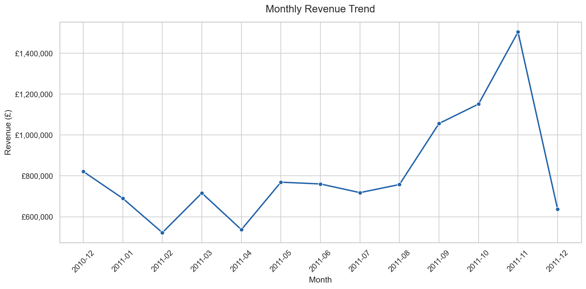
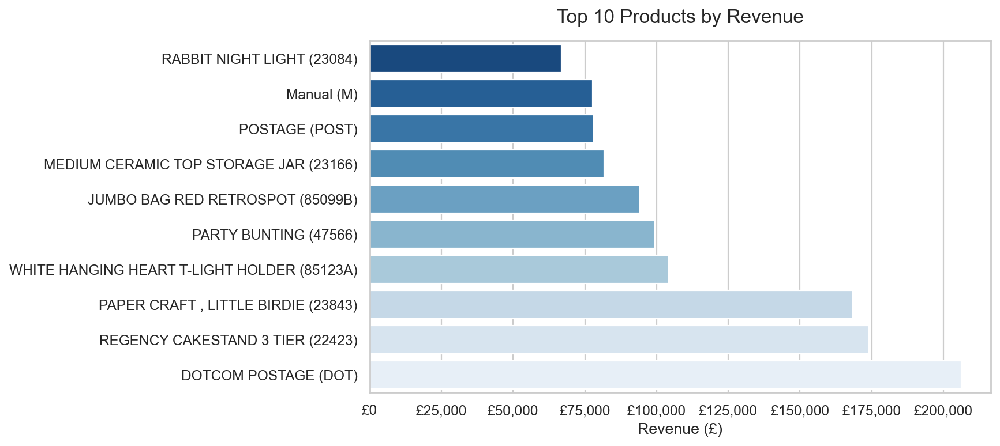
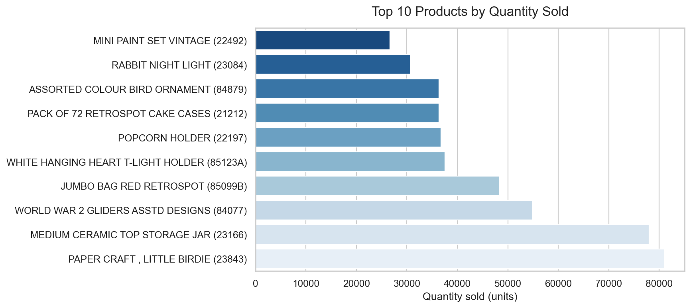
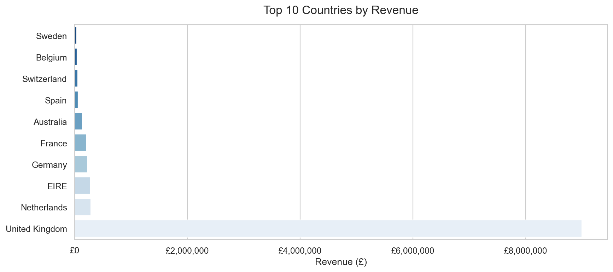
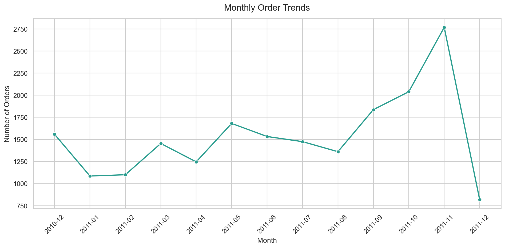
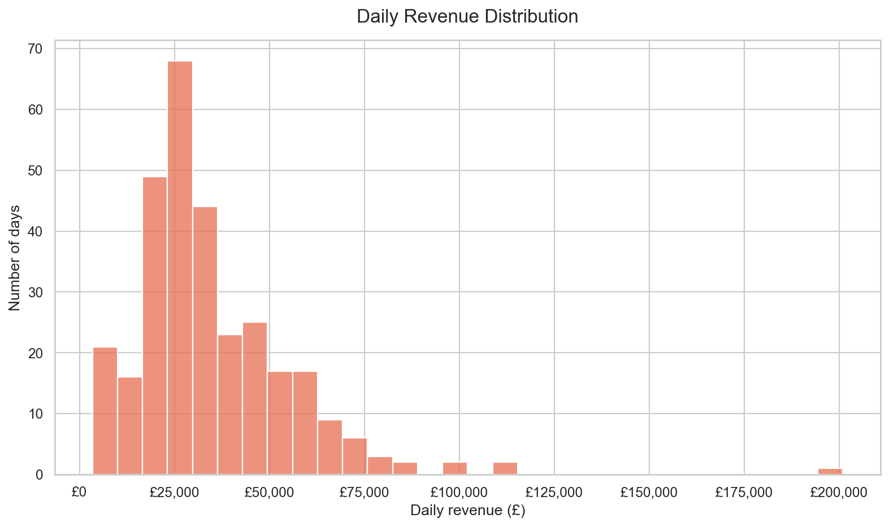
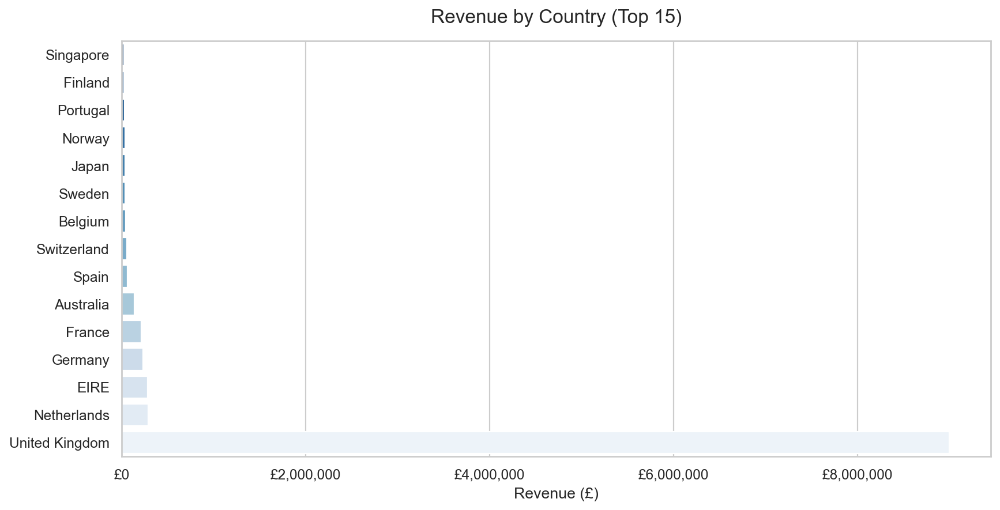

# E-Commerce Sales Analysis

A beginner-friendly Python project that analyzes the UCI Online Retail
transaction dataset. Run one script to clean the workbook, summarize sales and
customers, produce charts, and write evidence-based business observations.

> **Dataset note:** The source workbook is intentionally not tracked by Git.
> Download it from UCI and place it at `data/Online Retail.xlsx` before running
> the project. The project does not create or substitute sample sales data.

## Objectives

- Measure revenue, order volume, customer counts, order value, and quantity sold.
- Explore daily and monthly sales, popular products, and country-level revenue.
- Summarize purchasing behavior for transactions with a recorded customer ID.
- Produce reproducible CSV reports, PNG charts, and a business-insights report.

## Dataset

This project uses the [UCI Online Retail dataset](https://archive.ics.uci.edu/dataset/352/online+retail),
a transaction-level workbook for a UK-based online retailer. Its fields include
invoice and product identifiers, item descriptions, quantities, invoice dates,
unit prices, customer IDs, and countries.

The supplied workbook has 541,909 rows and eight columns. Customer IDs and some
product descriptions are missing in the source; the cleaning rules below
explain how those rows are treated.

The original dataset is excluded from Git by `.gitignore`. Check the UCI
dataset's current terms and file size before redistributing the workbook.

## Technologies

- Python 3.10 or newer
- pandas and NumPy
- Matplotlib and Seaborn
- openpyxl for reading Excel workbooks

## Project structure

```text
ecommerce-sales-analysis/
├── data/
│   └── Online Retail.xlsx       # Download separately; excluded from Git
├── outputs/
│   ├── charts/                  # Generated PNG visualizations
│   └── reports/                 # Generated CSV and text reports
├── src/
│   ├── __init__.py
│   ├── data_loader.py
│   ├── data_cleaning.py
│   ├── sales_analysis.py
│   └── visualization.py
├── main.py
├── requirements.txt
├── README.md
├── .gitignore
└── LICENSE
```

## Data cleaning decisions

The source workbook is loaded into memory and copied before cleaning; the
original workbook and input DataFrame are not overwritten.

- Column headers are normalized for whitespace/capitalization differences.
- Cancellation invoices (invoice numbers beginning with `C`) are excluded from
  sales analysis.
- Rows with missing required transaction fields or invalid dates are removed.
- Zero or negative quantities and zero or negative unit prices are excluded.
  Returns are therefore **not** included as sales or netted against purchases;
  this project reports positive sales only.
- Exact duplicate transaction rows are removed.
- Missing or blank descriptions are retained as
  `Unknown product description`; missing country labels are retained as
  `Unknown country`.
- Transactions without a `CustomerID` remain in revenue and order metrics.
  Customer-level metrics include only transactions with an identified customer.
- Revenue is calculated as `Quantity × UnitPrice`. Year, numeric month, month
  name, and a sortable `Year_Month` value are derived from `InvoiceDate`.
- Every cleaning decision is counted and printed when the workflow runs.

The `business_insights.txt` report also states these scope limitations.

## Exploratory analysis and reports

`main.py` calculates:

1. Total revenue, order count, identified unique customers, average order value,
   and total quantity sold.
2. Monthly revenue and monthly order trends.
3. Daily revenue and order totals.
4. Top 10 products by revenue and by quantity.
5. Revenue and order/customer/quantity summaries by country.
6. Customer-level order count, total spend, average order value, quantity, and
   first/last order dates.

Generated files in `outputs/reports/`:

- `summary_metrics.csv`
- `monthly_revenue.csv`
- `daily_sales.csv`
- `top_products_by_revenue.csv`
- `top_products_by_quantity.csv`
- `country_revenue.csv`
- `monthly_orders.csv`
- `customer_summary.csv`
- `business_insights.txt`

## Visualizations

Running the analysis generates these charts in `outputs/charts/`:

### Monthly revenue trend



### Top 10 products by revenue



### Top 10 products by quantity sold



### Top 10 countries by revenue



### Monthly order trends



### Daily revenue distribution



### Revenue by country



The charts use pound-sterling formatting as requested for this project. The
reports are calculated from the downloaded workbook when the script runs; no
results are hardcoded in the analysis code.

## Business insights

Actual findings are generated from the cleaned workbook and saved to
[`outputs/reports/business_insights.txt`](outputs/reports/business_insights.txt).
That report identifies the highest- and lowest-revenue months, leading products
and country, and the observed monthly sales range. It separates transaction
observations from suggested follow-up actions.

Recommendations are hypotheses for further investigation. Revenue is not
profit, missing customer IDs limit customer analysis, and aggregated patterns
do not establish seasonality or prove causation.

## Installation

Use Python 3.10 or newer. From this project folder, create and activate a
virtual environment:

```bash
python -m venv .venv
```

macOS/Linux:

```bash
source .venv/bin/activate
```

Windows PowerShell:

```powershell
.\.venv\Scripts\Activate.ps1
```

Install the dependencies:

```bash
python -m pip install -r requirements.txt
```

## Download the dataset

1. Open the [UCI Online Retail dataset page](https://archive.ics.uci.edu/dataset/352/online+retail).
2. Download the dataset workbook, `Online Retail.xlsx`.
3. Put it in this project's `data/` folder without renaming it.

If the workbook is missing, `main.py` prints the download page and expected
location.

## Run the project

From the `ecommerce-sales-analysis/` project root:

```bash
python main.py
```

The script inspects the data, prints a cleaning summary, performs the analysis,
saves CSV reports and charts, writes business insights, and prints a completion
message. Generated outputs can be recreated by running it again.

## Limitations

- Cancellation invoices and non-positive quantities/prices are excluded rather
  than analyzed as returns or refunds.
- Average order value is based on the mean of invoice totals in the included
  data; it is not a margin or profitability measure.
- Transactions without a customer ID are retained for sales metrics but cannot
  be attributed to an individual customer.
- The period and completeness of the downloaded workbook affect monthly
  comparisons. Partial months should not be treated as directly comparable
  without further investigation.
- Country revenue does not account for shipping costs, taxes, or profitability.
- The project is descriptive analysis; it does not demonstrate causal effects.

## Future improvements

- Add a returns/refunds analysis that reports cancellations separately.
- Compare full months and account for incomplete periods.
- Add profit and shipping-cost data if a suitable source becomes available.
- Explore customer cohorts and repeat-purchase timing.
- Add automated tests and configurable dataset/report paths.

## Author

Created as a beginner-friendly portfolio project. Replace this section with
your name and profile links before publishing.

## License

The analysis code is available under the [MIT License](LICENSE). The license
for this code does not change the terms that apply to the separately sourced
UCI dataset.
